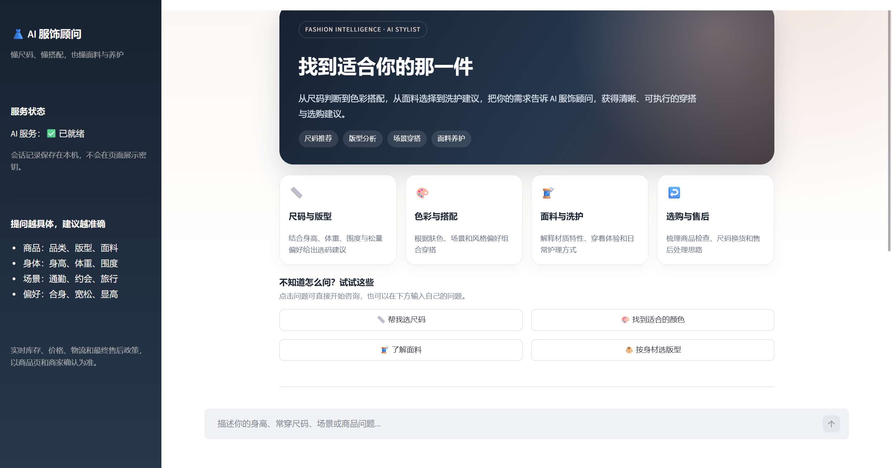
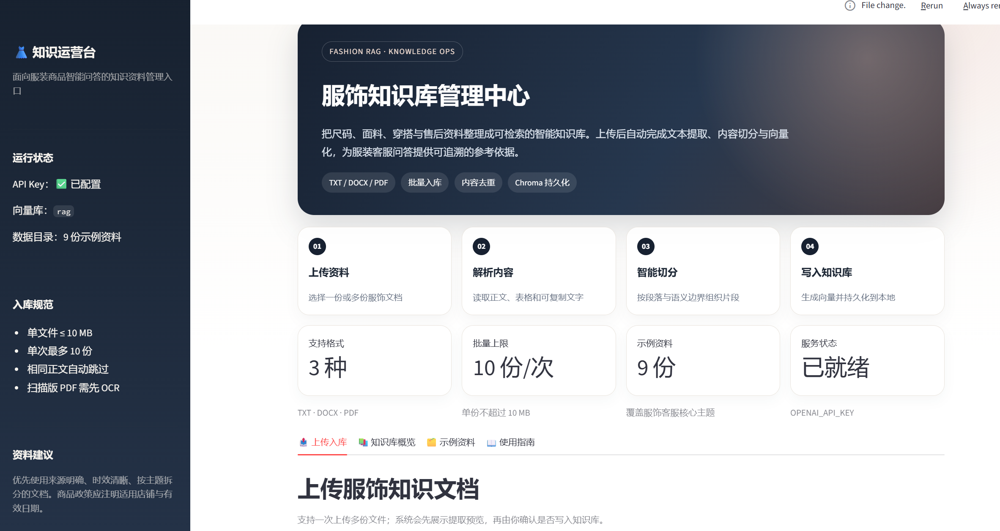
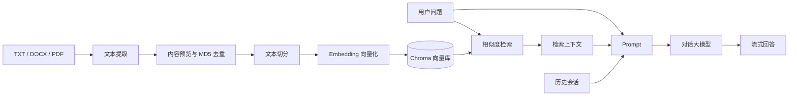

# 服饰商品智能问答客服（RAG）

这是一个面向服装商品场景的本地 RAG（Retrieval-Augmented Generation，检索增强生成）项目，包含一个知识文档管理页面和一个智能客服问答页面。上传尺码、面料、穿搭、洗护和售后资料后，系统会完成文本提取、切分与向量化；用户提问时，再从 Chroma 向量库召回相关内容并交给大模型生成回答。

当前版本重点增强了知识库上传页面，使其从单一文件上传入口升级为完整的知识运营中心，并新增多份服装商品知识文档。

## 页面预览

### AI 服饰顾问



面向用户的服饰问答入口，提供能力介绍、快捷提问、多轮对话和聊天历史恢复。

### 服饰知识库管理中心



面向管理人员的知识运营入口，支持批量上传、内容预览、示例资料导入和知识库统计。

## 主要功能

### 知识库管理

- 支持 `.txt`、`.docx`、`.pdf` 三种文档格式。
- 支持一次上传最多 10 份文件，单份最大 10 MB。
- 上传后先提取文本并展示预览，确认后再执行批量入库。
- 使用 MD5 对提取后的完整正文去重，相同内容重复上传会自动跳过。
- 显示知识库文档数、文本片段数、本地存储大小和最近入库时间。
- 内置 9 份服饰知识资料，可在页面中一键导入。
- 提供知识文档模板下载、入库规范和文档编写指南。
- 页面适配桌面端和移动端。

### 智能问答

- 使用 Chroma 持久化向量库进行语义检索。
- 将检索内容、历史会话和用户问题组合为提示词。
- 支持 Streamlit 流式回答。
- 提供面向消费者的服饰顾问首页、能力介绍和快捷问题入口。
- 支持尺码、色彩、面料、版型和售后等场景化快捷提问。
- 按浏览器会话隔离聊天历史，避免不同用户共用同一个记录。
- 刷新当前页面时会通过 URL 中的会话 ID 恢复可见聊天记录。
- 未配置 API Key 时展示明确提示，避免页面直接报错。
- 使用文件保存多轮对话历史。

## 系统架构



核心流程：

1. 上传文档并提取正文；Word 表格会转换为制表符分隔文本，PDF 会按页提取。
2. 对完整正文计算 MD5，避免重复向量。
3. 使用 `RecursiveCharacterTextSplitter` 切分文本。
4. 调用 DashScope OpenAI 兼容接口生成向量并写入本地 Chroma。
5. 用户提问时召回相关片段，结合历史记录生成回答。

## 项目结构

```text
RAG项目案例/
├── .gitignore
├── README.md                      # GitHub 项目说明
└── RAG项目/
    ├── app_file_uploader.py       # 知识库管理页面
    ├── app_qa.py                  # 智能客服页面
    ├── config_data.py             # 模型、切分和向量库配置
    ├── document_loader.py         # TXT、DOCX、PDF 文本提取
    ├── knowledge_base.py          # 去重、切分、入库和知识库统计
    ├── rag.py                     # RAG 检索与生成链
    ├── vector_stores.py           # Chroma 检索器封装
    ├── file_history_store.py      # 文件式会话历史
    ├── data/                      # 示例服饰知识文档
    ├── chroma_db/                 # 本地向量库，运行时生成
    ├── chat_history/              # 本地会话历史，运行时生成
    ├── md5.text                   # 已入库正文去重记录
    ├── docs/images/               # README 页面截图
    ├── .streamlit/config.toml     # 上传大小等服务配置
    └── requirements.txt
```

## 内置知识文档

`data/` 目录目前包含 9 份资料：

| 文档 | 内容 |
| --- | --- |
| `尺码推荐.txt` | 男女装通用尺码、特殊体型、围度测量 |
| `洗涤养护.txt` | 常见面料洗护、去渍和收纳 |
| `颜色选择.txt` | 肤色配色、场景用色和穿搭色彩法则 |
| `商品选购指南.txt` | 上衣、裤装、裙装、外套的选购与验货重点 |
| `面料材质指南.txt` | 棉麻、羊毛、真丝、聚酯、锦纶和混纺特性 |
| `版型与身材穿搭.txt` | 体型特征、松量、男女装廓形与搭配建议 |
| `场景穿搭建议.txt` | 通勤、商务、约会、旅行、运动和聚会场景 |
| `售后与退换指南.txt` | 退换检查、尺码换货、质量问题和包裹异常 |
| `常见商品FAQ.txt` | 色差、库存、起球、掉色、配件和人工客服等问答 |

这些资料用于演示 RAG 客服能力。实际商品参数、价格、库存、物流和售后政策，应以商品详情页、业务系统和商家最终确认为准。

## 环境要求

- Python 3.10 或更高版本
- 可访问 DashScope OpenAI 兼容接口的网络环境
- 有效的 DashScope API Key
- 当前依赖版本见 `requirements.txt`

当前项目提供的依赖包括 Streamlit、LangChain、LangChain-Chroma、ChromaDB、OpenAI SDK、PyPDF 和 python-docx。

## 快速开始

### 1. 创建虚拟环境并安装依赖

在 PowerShell 中执行：

```powershell
cd "D:\RAG项目案例"
python -m venv .venv
.\.venv\Scripts\Activate.ps1
python -m pip install -r "RAG项目\requirements.txt"
```

如果 PowerShell 禁止执行激活脚本，可以跳过激活，直接使用虚拟环境中的 Python：

```powershell
cd "D:\RAG项目案例"
python -m venv .venv
.\.venv\Scripts\python.exe -m pip install -r "RAG项目\requirements.txt"
```

### 2. 配置 API Key

当前代码通过 OpenAI 兼容客户端访问 DashScope，需要设置 `OPENAI_API_KEY`：

```powershell
$env:OPENAI_API_KEY = "你的 DashScope API Key"
```

在 CMD 中使用：

```cmd
set "OPENAI_API_KEY=你的 DashScope API Key"
```

环境变量只对当前终端会话生效。关闭终端后重新启动页面时，需要再次设置。不要把真实 Key 写入源码或提交到版本库。

### 3. 启动知识库管理页面

```powershell
cd "D:\RAG项目案例\RAG项目"
..\.venv\Scripts\python.exe -m streamlit run app_file_uploader.py --server.port 8502
```

浏览器访问：

```text
http://localhost:8502
```

### 4. 启动智能客服页面

另开一个 PowerShell 或 CMD 窗口，设置同一个 API Key 后执行：

```powershell
cd "D:\RAG项目案例\RAG项目"
..\.venv\Scripts\python.exe -m streamlit run app_qa.py
```

浏览器访问：

```text
http://localhost:8501
```

## 问答页面使用说明

`app_qa.py` 是面向最终用户的智能客服入口，页面包含：

- 品牌化欢迎区和服务能力介绍。
- “帮我选尺码”“找到适合的颜色”“了解面料”“按身材选版型”等快捷问题。
- 支持多轮上下文和流式回答。
- API Key 未配置或模型请求失败时的可读错误提示。

用户可以直接点击快捷问题，也可以在底部输入框描述具体需求。建议提问时同时提供商品品类、身高体重或常穿尺码、使用场景和版型偏好，例如：

```text
我身高 175cm、体重 80kg，想买一件偏宽松的男士夹克，平时穿 L 码，应该选 L 还是 XL？
```

页面首次加载时会生成独立 `session_id`，并将其写入当前 URL，例如：

```text
http://localhost:8501/?session_id=user_1a2b3c4d5e6f
```

直接刷新当前 URL 时，页面会根据 `session_id` 从 `chat_history/` 恢复聊天内容；打开不带该参数的链接则会创建新会话。该参数相当于本地会话凭证，不要把包含聊天内容的页面链接分享给无关人员。

## 知识库页面使用说明

页面包含四个标签页：

### 上传入库

1. 拖入或选择一份或多份 TXT、DOCX、PDF 文件。
2. 系统展示文件格式、大小、提取字符数和内容预览。
3. 确认内容无误后点击“开始批量入库”。
4. 页面显示每份文件的处理结果和文本片段数。

注意：

- 同一批次超过 10 份时，只处理前 10 份。
- 单份文件超过 10 MB 会被拒绝。
- 相同正文已入库时不会重复写入。
- 扫描版 PDF 没有文本层，需要先做 OCR。

### 知识库概览

点击“刷新知识库统计”可查看：

- 已入库文档数量
- Chroma 中的文本片段数量
- `data/` 目录占用的存储空间
- 最近入库时间
- 每份文档对应的片段数和更新时间

其中“本地存储”统计的是 `data/` 示例资料目录，不包含 `chroma_db/` 的实际磁盘占用。

### 示例资料

展示 9 份内置资料的内容摘要。点击“导入全部示例资料”可以批量写入向量库；重复导入会被 MD5 去重。

### 使用指南

提供知识文档推荐结构、入库前检查项和常见问题说明。

## 快速体验建议

1. 启动知识库页面并配置 API Key。
2. 在“示例资料”页点击“导入全部示例资料”。
3. 等全部文件处理完成后再启动问答页面。
4. 尝试提问：
   - “身高 175cm、体重 80kg，男装夹克应该选什么尺码？”
   - “羊毛大衣能不能机洗？”
   - “黄黑皮适合穿什么颜色的衬衫？”
   - “收到衣服发现少了一颗纽扣，应该怎么处理？”
   - “我胯宽、肩窄，适合什么裤型？”

## 关键配置

配置集中在 `config_data.py`：

| 参数 | 当前值 | 说明 |
| --- | --- | --- |
| `collection_name` | `rag` | Chroma 集合名称 |
| `persist_directory` | `./chroma_db` | 向量库持久化目录 |
| `chunk_size` | `150` | 单个文本片段的最大字符数 |
| `chunk_overlap` | `20` | 相邻片段重叠字符数 |
| `embedding_batch_size` | `10` | 单次嵌入请求的文本数量 |
| `similarity_threshold` | `1` | 当前实际作为检索返回的片段数 `k` |
| `embedding_model_name` | `text-embedding-v4` | 嵌入模型名称 |
| `chat_model_name` | `glm-5.3` | 对话模型名称 |
| `base_url` | DashScope 兼容地址 | OpenAI 兼容接口地址 |

`similarity_threshold` 这个变量名沿用了旧代码，但在 `vector_stores.py` 中实际设置为 Chroma 检索器返回的文档数量。希望一次召回多个片段时，可将其改为 `3` 或 `5`；修改后建议重新检查回答质量。

如果当前 DashScope 账号未开通默认对话模型，请将 `chat_model_name` 改为账号支持的有效模型。修改嵌入模型或向量维度后，需要重建向量库，否则新旧向量可能不兼容。

## 数据与安全

- `chroma_db/`、`chat_history/`、`md5.text` 是本地运行数据，已被 `.gitignore` 排除。
- API Key 只通过环境变量读取，不应写入代码、日志或截图。
- 文档入库会调用远程嵌入接口，上传前请确认文档不含客户隐私、支付信息、账号密码等敏感数据。
- 生产环境应增加鉴权、用户隔离、访问日志、限流、失败重试和数据脱敏。

## 已知限制

1. 当前没有单文档删除或更新按钮，过期知识需要重建集合或通过维护脚本清理。
2. Word 和 PDF 中的图片、图表不会自动识别；需要先转成文字。
3. 聊天历史保存在本机文件中，同一 URL 刷新可恢复；更换浏览器、删除 URL 参数或跨设备访问时无法自动关联原会话。
4. 本地文件会话和 Chroma 更适合单机演示，不适合直接用于高并发生产部署。
5. 大模型仍可能生成不准确内容。提示词要求参考资料不足时回答“不知道”，但生产环境还应增加引用来源、答案校验和人工兜底。
6. 商品库存、实时价格、订单状态和物流节点不应只依赖 RAG 文档，应接入业务 API。

## 后续可扩展方向

- 支持 Markdown、旧版 DOC、OCR 扫描件和异步批量上传。
- 增加文档删除、版本管理、生效时间和知识审核流程。
- 使用 BM25 + 向量混合检索、重排序和相似度阈值过滤。
- 在回答中展示引用文件名、片段和相关度。
- 将会话迁移到 Redis/数据库，并为每个用户生成独立会话 ID。
- 增加商品参数数据库、实时库存 API 和订单售后接口。
- 增加自动化测试、Docker 部署、健康检查和 CI。

## 验证情况

当前版本已完成以下本地验证：

- Python 语法编译检查通过。
- 9 份 TXT 文档均可正常提取中文正文。
- Chroma 现有集合统计读取正常。
- Streamlit 页面可正常启动。
- 已检查知识库管理页面的桌面端和 390px 移动端布局。
- 已检查文件上传、解析预览、批量入库按钮和知识库统计界面。
- 已检查问答页面的欢迎区、快捷提问、输入框和会话状态。

实际问答效果以及示例资料的一键入库结果，仍取决于 API Key、账号模型权限、网络环境和向量库状态。
