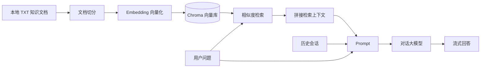

# 服饰商品智能问答系统

一个面向服饰商品知识场景的 RAG（Retrieval-Augmented Generation，检索增强生成）问答项目。系统将本地尺码推荐、洗涤养护、颜色选择等知识文档转换为向量，在用户提问时检索相关片段并交给大模型生成回答，从而降低垂直领域问答中的事实性幻觉。

## 项目亮点

- **本地知识库驱动**：基于上传的 TXT 文档构建 Chroma 向量库，回答优先依据本地资料。
- **双链路设计**：离线完成文档解析、切分与向量化；在线完成语义检索、上下文拼接与流式生成。
- **动态知识更新**：通过 Streamlit 上传页面管理知识文档，并使用 MD5 避免重复入库。
- **多轮对话**：使用 `RunnableWithMessageHistory` 和文件会话存储保存上下文。
- **流式交互**：回答通过 Streamlit 实时输出，改善等待体验。
- **可替换模型服务**：通过 OpenAI 兼容接口接入 DashScope 的对话模型与嵌入模型。

## 系统架构



核心流程如下：

1. 上传知识文档，按配置的块大小与重叠长度进行切分。
2. 调用嵌入模型生成向量，并写入本地 Chroma 持久化目录。
3. 用户提问后，根据语义相似度召回相关文档片段。
4. 将召回内容、历史对话和当前问题组装为提示词。
5. 大模型生成基于检索上下文的回答并通过 Streamlit 流式展示。

## 项目结构

```text
RAG项目案例/
├── RAG项目/
│   ├── app_file_uploader.py     # 知识库上传页面
│   ├── app_qa.py                # 智能问答页面
│   ├── config_data.py           # 模型、切分与向量库配置
│   ├── knowledge_base.py        # 文档切分、向量化与去重入库
│   ├── rag.py                   # RAG 检索与生成链
│   ├── vector_stores.py         # Chroma 检索器封装
│   ├── file_history_store.py    # 文件式多轮会话存储
│   └── data/                    # 示例服饰知识文档
├── .gitignore
├── README.md
└── requirements.txt
```

## 环境要求

- Python 3.10+
- 可访问 DashScope OpenAI 兼容接口的网络环境
- 有效的 DashScope API Key

本项目已在本地虚拟环境中使用 Streamlit、LangChain、LangChain-Chroma 和 ChromaDB 完成开发。建议使用 Python 3.10 至 3.13 创建独立虚拟环境。

## 快速开始

### 1. 安装依赖

```powershell
cd "D:\RAG项目案例"
python -m venv .venv
.\.venv\Scripts\Activate.ps1
python -m pip install -r requirements.txt
```

如果 PowerShell 禁止执行激活脚本，可以不激活虚拟环境，直接运行：

```powershell
.\.venv\Scripts\python.exe -m pip install -r requirements.txt
```

### 2. 配置 API Key

当前代码通过 OpenAI 兼容客户端访问 DashScope，因此需要设置 `OPENAI_API_KEY`：

```powershell
$env:OPENAI_API_KEY = "你的 DashScope API Key"
```

密钥只应保存在当前终端环境或本地 `.env` 文件中。`.env` 已被 `.gitignore` 排除，禁止将真实密钥提交到 GitHub。

请在 `RAG项目/config_data.py` 中确认以下配置适用于你的账号：

```python
embedding_model_name = "text-embedding-v4"
base_url = "https://dashscope.aliyuncs.com/compatible-mode/v1"
chat_model_name = "glm-5.3"
```

> 注意：当前默认对话模型为 `glm-5.3`。如果该模型未在所使用的 DashScope 账号中开通，请将其替换为账号支持的有效模型名称。

### 3. 启动问答页面

```powershell
cd "D:\RAG项目案例\RAG项目"
..\.venv\Scripts\python.exe -m streamlit run app_qa.py
```

浏览器默认打开 `http://localhost:8501`。

### 4. 更新知识库

另开一个终端，启动知识库管理页面：

```powershell
cd "D:\RAG项目案例\RAG项目"
..\.venv\Scripts\python.exe -m streamlit run app_file_uploader.py --server.port 8502
```

访问 `http://localhost:8502`，上传 UTF-8 编码的 TXT 文件。文件内容会经过切分、向量化并写入本地 Chroma 数据库；相同内容再次上传时会提示已存在。

示例知识文档位于 `RAG项目/data/`：

- `尺码推荐.txt`
- `洗涤养护.txt`
- `颜色选择.txt`

## 关键配置

配置集中在 `RAG项目/config_data.py`：

| 参数 | 说明 |
| --- | --- |
| `chunk_size` | 文本切分块大小，当前为 150 |
| `chunk_overlap` | 相邻文本块重叠长度，当前为 20 |
| `similarity_threshold` | 检索返回的文档数量，当前为 1 |
| `collection_name` | Chroma 集合名称 |
| `persist_directory` | Chroma 本地持久化目录 |
| `session_config` | 演示用会话标识，当前固定为 `user_001` |

## 使用说明

1. 首次运行前上传至少一份知识文档。
2. 在问答页输入服饰相关问题，例如“我身高 175cm、体重 80kg，应该选择什么尺码？”。
3. 系统将召回最相关的知识片段，并结合当前会话历史生成回答。
4. 更新知识文档后无需修改代码，重新上传即可扩展知识库。

## 注意事项

- 当前上传入口一次仅接受一个 TXT 文件，并要求文件使用 UTF-8 编码。
- `chroma_db/`、`chat_history/` 和 `md5.text` 是本机运行数据，已被 `.gitignore` 排除，不会上传到 GitHub。
- 示例代码使用固定会话 ID `user_001`。多人同时访问时可能共享历史记录，生产环境应按用户或浏览器会话生成唯一 ID。
- 文件会话和本地向量库不适合直接用于高并发生产环境；如需部署，建议迁移到数据库、Redis 或托管向量服务，并增加鉴权、限流、日志脱敏和失败重试。
- 大模型仍可能生成不准确内容。当前提示词要求“参考资料中没有提到时回答不知道”，实际部署时还应增加引用来源、答案校验和人工兜底机制。
- 修改 `chunk_size`、嵌入模型或向量维度后，应重建向量库，避免新旧向量维度不一致。

## 后续可扩展方向

- 支持 PDF、Markdown、Word 等文档格式以及批量上传。
- 加入 BM25 与向量召回的混合检索、重排序和相似度阈值过滤。
- 增加引用来源展示、知识库管理后台和文档删除/更新能力。
- 使用数据库保存会话，并实现按用户隔离的多会话管理。
- 增加自动化测试、Docker 部署和 CI 检查。

